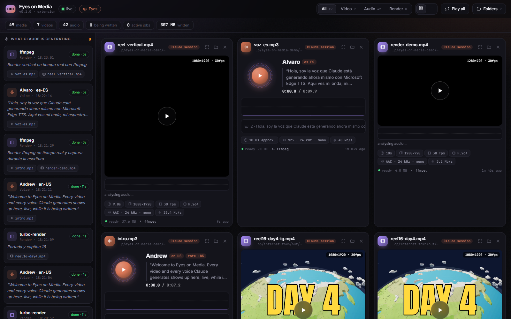

# 🎬 Eyes on Media

**An [Eyes on Claude](https://github.com/dfadify-web/eyes-on-claude) extension: watch the videos and voice-overs Claude is generating with code, live.**

[Español](README.es.md)



When Claude renders a video (ffmpeg, Remotion, turbo-render, Blender, MoviePy…) or synthesizes a voice with **Microsoft Edge TTS**, Eyes on Media shows it while it is being written to disk:

- **Live render cards** — real file size growing, MB/s, a size curve, elapsed time. The moment the file is closed it turns into a player.
- **Video player** — resolution, fps, codec, bitrate and audio track read from the real MP4 headers, filmstrip thumbnails, audio waveform under the video, “Play all” wall mode to watch several videos at once.
- **Voice cards for edge-tts** — the voice, locale, rate and exact text are read from the real command Claude ran; a live radial spectrum while it plays, waveform, and karaoke subtitles from the `.srt/.vtt` edge-tts writes.
- **Large view** — big waveform, live spectrum, **spectrogram** (FFT, 40 Hz–16 kHz), clickable subtitles, file details and the exact command.
- **Render chunks** — turbo-render's parallel `seg_*.mp4` chunks in `%TEMP%` light up one by one; frame sequences (`frame_0001.png…`) show the latest real frame.
- **“What Claude is generating”** — every `edge-tts` / `ffmpeg` / render command (or a script whose code calls them) with its status and timer, linked to the files it produces.

Nothing is guessed: everything comes from files on disk and from the commands in Claude Code's transcript (via Eyes on Claude).

## Install

Requires Eyes on Claude **v2.3+** and Node 18+.

```bash
npx -y github:dfadify-web/eyes-on-media
```

Then open Eyes on Claude → **Extensions** → **Eyes on Media** (`http://localhost:7777/#ext/eyes-on-media`). It starts with Eyes on Claude (`autostart`). Uninstall with `npx -y github:dfadify-web/eyes-on-media --uninstall`.

Standalone: `node server/server.js` → `http://localhost:7778`.

## What it watches

- The working folders of your Claude Code sessions (recursively, skipping `node_modules`, `.git`, venvs…).
- The exact folders of media files mentioned in Claude's commands.
- The system temp folder (where Remotion and turbo-render work).
- Any folder you add from **Folders** (saved in `~/.claude/eyes-on-claude/eyes-on-media.json`) or via `EOM_DIRS`.

Env: `EOM_PORT` (7778), `EYES_PORT` (7777), `EOM_DIRS`, `EOM_KEEP_ALIVE=1`. The server only listens on 127.0.0.1 and only serves files it has registered as media.

## Develop

```bash
npm install
npm run dev     # Vite on :5178, proxied to the server on :7778
npm run build   # writes dist/ (committed so npx installs need no build)
npm test
```

React 18 + Vite + Motion for the UI; the server has zero runtime dependencies.

MIT © dfadify-web
